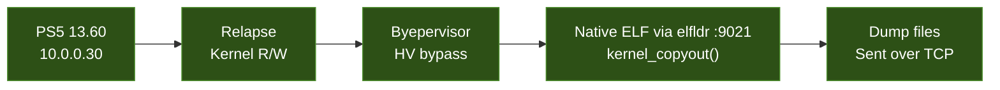
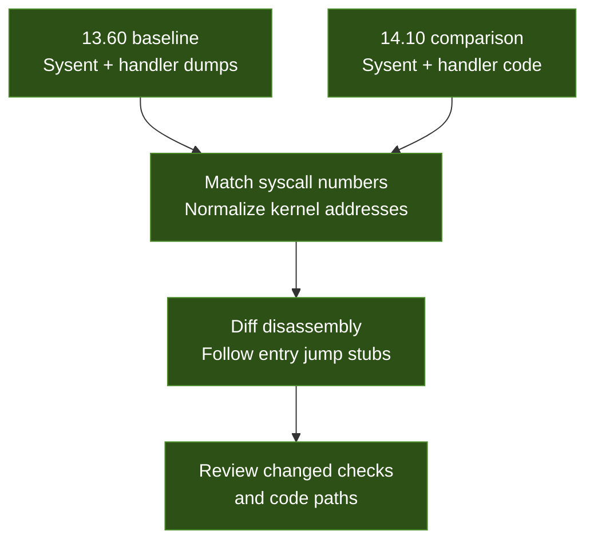

# PS5 Firmware 13.60 - Kernel Dumps

Raw kernel data dumps extracted from a jailbroken PS5 on firmware **13.60** using **Relapse + Byepervisor**.

> **Goal:** Map the Sony syscall table and handler code, then diff against **14.10** to find exploitable changes.

## Extraction Method



The native ELF is loaded through `elfldr` on TCP port **9021**, uses `kernel_copyout()` to read kernel memory, and sends the resulting dump files over TCP.

## Kernel Layout

| Property | Value |
|----------|-------|
| Firmware | 13.60 |
| Kernel base | `0xffffffff8a9c0000` |
| Sysent RVA | `+0xe6e5c0` |
| Sysent entries | 679, with a 48-byte stride |
| Active handlers | 311 (368 entries are `nosys` stubs) |
| Sony syscalls (532-676) | 145 entries; 117 with real handlers in the research tally (see note below) |

> **Count verification:** The current `sysent_index.json` contains **115 non-`nosys` entries** and 30 `nosys` entries in the inclusive range 532-676, using syscall 0's `sy_call` (`0xffffffff8ac25760`) as the `nosys` pointer. The supplied 117-handler research tally needs reconciliation with this index.

## Files

The reference dumps listed below currently reside in the [14.10 companion repository](https://github.com/ZigZagBoi1/PS5-14.10-Research/tree/master/docs/dumps_13.60). File links point to those existing captures; this guide is maintained in the 13.60 repository.

The complete sysent occupies **32,592 B** (`679 * 48`). Each of the **145** files from `handler_532.bin` through `handler_676.bin` contains **4,096 B**, starting at that syscall's `sy_call` address. Entries that share an address, including `nosys` entries, can produce duplicate dumps. A 4 KB window may include a jump stub or adjacent code and may not contain the entire handler.

| File | Size | Contents |
|------|------|----------|
| [`README.md`](README.md) | - | This guide to extraction, layout, and comparison. |
| [`sysent_raw.bin`](https://github.com/ZigZagBoi1/PS5-14.10-Research/blob/master/docs/dumps_13.60/sysent_raw.bin) | 32,592 B | Complete raw sysent table: 679 entries with a 48-byte stride. |
| [`sysent_index.json`](https://github.com/ZigZagBoi1/PS5-14.10-Research/blob/master/docs/dumps_13.60/sysent_index.json) | 80,795 B | Parsed sysent with syscall number, argument count, `sy_call`, and handler RVA. |
| [`kernel_base.txt`](https://github.com/ZigZagBoi1/PS5-14.10-Research/blob/master/docs/dumps_13.60/kernel_base.txt) | 45 B | Firmware version and kernel base recorded during extraction. |
| [`ucred.bin`](https://github.com/ZigZagBoi1/PS5-14.10-Research/blob/master/docs/dumps_13.60/ucred.bin) | 256 B | Raw credential structure (`ucred`). |
| [`handler_532.bin`](https://github.com/ZigZagBoi1/PS5-14.10-Research/blob/master/docs/dumps_13.60/handler_532.bin) | 4,096 B | First 4 KB at the Sony syscall 532 handler address. |
| [`handler_533.bin`](https://github.com/ZigZagBoi1/PS5-14.10-Research/blob/master/docs/dumps_13.60/handler_533.bin) | 4,096 B | First 4 KB at the Sony syscall 533 handler address. |
| [`handler_534.bin`](https://github.com/ZigZagBoi1/PS5-14.10-Research/blob/master/docs/dumps_13.60/handler_534.bin) | 4,096 B | First 4 KB at the Sony syscall 534 handler address. |
| [`handler_535.bin`](https://github.com/ZigZagBoi1/PS5-14.10-Research/blob/master/docs/dumps_13.60/handler_535.bin) | 4,096 B | First 4 KB at the Sony syscall 535 handler address. |
| [`handler_536.bin`](https://github.com/ZigZagBoi1/PS5-14.10-Research/blob/master/docs/dumps_13.60/handler_536.bin) | 4,096 B | First 4 KB at the Sony syscall 536 handler address. |
| [`handler_537.bin`](https://github.com/ZigZagBoi1/PS5-14.10-Research/blob/master/docs/dumps_13.60/handler_537.bin) | 4,096 B | First 4 KB at the Sony syscall 537 handler address. |
| [`handler_538.bin`](https://github.com/ZigZagBoi1/PS5-14.10-Research/blob/master/docs/dumps_13.60/handler_538.bin) | 4,096 B | First 4 KB at the Sony syscall 538 handler address. |
| [`handler_539.bin`](https://github.com/ZigZagBoi1/PS5-14.10-Research/blob/master/docs/dumps_13.60/handler_539.bin) | 4,096 B | First 4 KB at the Sony syscall 539 handler address. |
| [`handler_540.bin`](https://github.com/ZigZagBoi1/PS5-14.10-Research/blob/master/docs/dumps_13.60/handler_540.bin) | 4,096 B | First 4 KB at the Sony syscall 540 handler address. |
| [`handler_541.bin`](https://github.com/ZigZagBoi1/PS5-14.10-Research/blob/master/docs/dumps_13.60/handler_541.bin) | 4,096 B | First 4 KB at the Sony syscall 541 handler address. |
| [`handler_542.bin`](https://github.com/ZigZagBoi1/PS5-14.10-Research/blob/master/docs/dumps_13.60/handler_542.bin) | 4,096 B | First 4 KB at the Sony syscall 542 handler address. |
| [`handler_543.bin`](https://github.com/ZigZagBoi1/PS5-14.10-Research/blob/master/docs/dumps_13.60/handler_543.bin) | 4,096 B | First 4 KB at the Sony syscall 543 handler address. |
| [`handler_544.bin`](https://github.com/ZigZagBoi1/PS5-14.10-Research/blob/master/docs/dumps_13.60/handler_544.bin) | 4,096 B | First 4 KB at the Sony syscall 544 handler address. |
| [`handler_545.bin`](https://github.com/ZigZagBoi1/PS5-14.10-Research/blob/master/docs/dumps_13.60/handler_545.bin) | 4,096 B | First 4 KB at the Sony syscall 545 handler address. |
| [`handler_546.bin`](https://github.com/ZigZagBoi1/PS5-14.10-Research/blob/master/docs/dumps_13.60/handler_546.bin) | 4,096 B | First 4 KB at the Sony syscall 546 handler address. |
| [`handler_547.bin`](https://github.com/ZigZagBoi1/PS5-14.10-Research/blob/master/docs/dumps_13.60/handler_547.bin) | 4,096 B | First 4 KB at the Sony syscall 547 handler address. |
| [`handler_548.bin`](https://github.com/ZigZagBoi1/PS5-14.10-Research/blob/master/docs/dumps_13.60/handler_548.bin) | 4,096 B | First 4 KB at the Sony syscall 548 handler address. |
| [`handler_549.bin`](https://github.com/ZigZagBoi1/PS5-14.10-Research/blob/master/docs/dumps_13.60/handler_549.bin) | 4,096 B | First 4 KB at the Sony syscall 549 handler address. |
| [`handler_550.bin`](https://github.com/ZigZagBoi1/PS5-14.10-Research/blob/master/docs/dumps_13.60/handler_550.bin) | 4,096 B | First 4 KB at the Sony syscall 550 handler address. |
| [`handler_551.bin`](https://github.com/ZigZagBoi1/PS5-14.10-Research/blob/master/docs/dumps_13.60/handler_551.bin) | 4,096 B | First 4 KB at the Sony syscall 551 handler address. |
| [`handler_552.bin`](https://github.com/ZigZagBoi1/PS5-14.10-Research/blob/master/docs/dumps_13.60/handler_552.bin) | 4,096 B | First 4 KB at the Sony syscall 552 handler address. |
| [`handler_553.bin`](https://github.com/ZigZagBoi1/PS5-14.10-Research/blob/master/docs/dumps_13.60/handler_553.bin) | 4,096 B | First 4 KB at the Sony syscall 553 handler address. |
| [`handler_554.bin`](https://github.com/ZigZagBoi1/PS5-14.10-Research/blob/master/docs/dumps_13.60/handler_554.bin) | 4,096 B | First 4 KB at the Sony syscall 554 handler address. |
| [`handler_555.bin`](https://github.com/ZigZagBoi1/PS5-14.10-Research/blob/master/docs/dumps_13.60/handler_555.bin) | 4,096 B | First 4 KB at the Sony syscall 555 handler address. |
| [`handler_556.bin`](https://github.com/ZigZagBoi1/PS5-14.10-Research/blob/master/docs/dumps_13.60/handler_556.bin) | 4,096 B | First 4 KB at the Sony syscall 556 handler address. |
| [`handler_557.bin`](https://github.com/ZigZagBoi1/PS5-14.10-Research/blob/master/docs/dumps_13.60/handler_557.bin) | 4,096 B | First 4 KB at the Sony syscall 557 handler address. |
| [`handler_558.bin`](https://github.com/ZigZagBoi1/PS5-14.10-Research/blob/master/docs/dumps_13.60/handler_558.bin) | 4,096 B | First 4 KB at the Sony syscall 558 handler address. |
| [`handler_559.bin`](https://github.com/ZigZagBoi1/PS5-14.10-Research/blob/master/docs/dumps_13.60/handler_559.bin) | 4,096 B | First 4 KB at the Sony syscall 559 handler address. |
| [`handler_560.bin`](https://github.com/ZigZagBoi1/PS5-14.10-Research/blob/master/docs/dumps_13.60/handler_560.bin) | 4,096 B | First 4 KB at the Sony syscall 560 handler address. |
| [`handler_561.bin`](https://github.com/ZigZagBoi1/PS5-14.10-Research/blob/master/docs/dumps_13.60/handler_561.bin) | 4,096 B | First 4 KB at the Sony syscall 561 handler address. |
| [`handler_562.bin`](https://github.com/ZigZagBoi1/PS5-14.10-Research/blob/master/docs/dumps_13.60/handler_562.bin) | 4,096 B | First 4 KB at the Sony syscall 562 handler address. |
| [`handler_563.bin`](https://github.com/ZigZagBoi1/PS5-14.10-Research/blob/master/docs/dumps_13.60/handler_563.bin) | 4,096 B | First 4 KB at the Sony syscall 563 handler address. |
| [`handler_564.bin`](https://github.com/ZigZagBoi1/PS5-14.10-Research/blob/master/docs/dumps_13.60/handler_564.bin) | 4,096 B | First 4 KB at the Sony syscall 564 handler address. |
| [`handler_565.bin`](https://github.com/ZigZagBoi1/PS5-14.10-Research/blob/master/docs/dumps_13.60/handler_565.bin) | 4,096 B | First 4 KB at the Sony syscall 565 handler address. |
| [`handler_566.bin`](https://github.com/ZigZagBoi1/PS5-14.10-Research/blob/master/docs/dumps_13.60/handler_566.bin) | 4,096 B | First 4 KB at the Sony syscall 566 handler address. |
| [`handler_567.bin`](https://github.com/ZigZagBoi1/PS5-14.10-Research/blob/master/docs/dumps_13.60/handler_567.bin) | 4,096 B | First 4 KB at the Sony syscall 567 handler address. |
| [`handler_568.bin`](https://github.com/ZigZagBoi1/PS5-14.10-Research/blob/master/docs/dumps_13.60/handler_568.bin) | 4,096 B | First 4 KB at the Sony syscall 568 handler address. |
| [`handler_569.bin`](https://github.com/ZigZagBoi1/PS5-14.10-Research/blob/master/docs/dumps_13.60/handler_569.bin) | 4,096 B | First 4 KB at the Sony syscall 569 handler address. |
| [`handler_570.bin`](https://github.com/ZigZagBoi1/PS5-14.10-Research/blob/master/docs/dumps_13.60/handler_570.bin) | 4,096 B | First 4 KB at the Sony syscall 570 handler address. |
| [`handler_571.bin`](https://github.com/ZigZagBoi1/PS5-14.10-Research/blob/master/docs/dumps_13.60/handler_571.bin) | 4,096 B | First 4 KB at the Sony syscall 571 handler address. |
| [`handler_572.bin`](https://github.com/ZigZagBoi1/PS5-14.10-Research/blob/master/docs/dumps_13.60/handler_572.bin) | 4,096 B | First 4 KB at the Sony syscall 572 handler address. |
| [`handler_573.bin`](https://github.com/ZigZagBoi1/PS5-14.10-Research/blob/master/docs/dumps_13.60/handler_573.bin) | 4,096 B | First 4 KB at the Sony syscall 573 handler address. |
| [`handler_574.bin`](https://github.com/ZigZagBoi1/PS5-14.10-Research/blob/master/docs/dumps_13.60/handler_574.bin) | 4,096 B | First 4 KB at the Sony syscall 574 handler address. |
| [`handler_575.bin`](https://github.com/ZigZagBoi1/PS5-14.10-Research/blob/master/docs/dumps_13.60/handler_575.bin) | 4,096 B | First 4 KB at the Sony syscall 575 handler address. |
| [`handler_576.bin`](https://github.com/ZigZagBoi1/PS5-14.10-Research/blob/master/docs/dumps_13.60/handler_576.bin) | 4,096 B | First 4 KB at the Sony syscall 576 handler address. |
| [`handler_577.bin`](https://github.com/ZigZagBoi1/PS5-14.10-Research/blob/master/docs/dumps_13.60/handler_577.bin) | 4,096 B | First 4 KB at the Sony syscall 577 handler address. |
| [`handler_578.bin`](https://github.com/ZigZagBoi1/PS5-14.10-Research/blob/master/docs/dumps_13.60/handler_578.bin) | 4,096 B | First 4 KB at the Sony syscall 578 handler address. |
| [`handler_579.bin`](https://github.com/ZigZagBoi1/PS5-14.10-Research/blob/master/docs/dumps_13.60/handler_579.bin) | 4,096 B | First 4 KB at the Sony syscall 579 handler address. |
| [`handler_580.bin`](https://github.com/ZigZagBoi1/PS5-14.10-Research/blob/master/docs/dumps_13.60/handler_580.bin) | 4,096 B | First 4 KB at the Sony syscall 580 handler address. |
| [`handler_581.bin`](https://github.com/ZigZagBoi1/PS5-14.10-Research/blob/master/docs/dumps_13.60/handler_581.bin) | 4,096 B | First 4 KB at the Sony syscall 581 handler address. |
| [`handler_582.bin`](https://github.com/ZigZagBoi1/PS5-14.10-Research/blob/master/docs/dumps_13.60/handler_582.bin) | 4,096 B | First 4 KB at the Sony syscall 582 handler address. |
| [`handler_583.bin`](https://github.com/ZigZagBoi1/PS5-14.10-Research/blob/master/docs/dumps_13.60/handler_583.bin) | 4,096 B | First 4 KB at the Sony syscall 583 handler address. |
| [`handler_584.bin`](https://github.com/ZigZagBoi1/PS5-14.10-Research/blob/master/docs/dumps_13.60/handler_584.bin) | 4,096 B | First 4 KB at the Sony syscall 584 handler address. |
| [`handler_585.bin`](https://github.com/ZigZagBoi1/PS5-14.10-Research/blob/master/docs/dumps_13.60/handler_585.bin) | 4,096 B | First 4 KB at the Sony syscall 585 handler address. |
| [`handler_586.bin`](https://github.com/ZigZagBoi1/PS5-14.10-Research/blob/master/docs/dumps_13.60/handler_586.bin) | 4,096 B | First 4 KB at the Sony syscall 586 handler address. |
| [`handler_587.bin`](https://github.com/ZigZagBoi1/PS5-14.10-Research/blob/master/docs/dumps_13.60/handler_587.bin) | 4,096 B | First 4 KB at the Sony syscall 587 handler address. |
| [`handler_588.bin`](https://github.com/ZigZagBoi1/PS5-14.10-Research/blob/master/docs/dumps_13.60/handler_588.bin) | 4,096 B | First 4 KB at the Sony syscall 588 handler address. |
| [`handler_589.bin`](https://github.com/ZigZagBoi1/PS5-14.10-Research/blob/master/docs/dumps_13.60/handler_589.bin) | 4,096 B | First 4 KB at the Sony syscall 589 handler address. |
| [`handler_590.bin`](https://github.com/ZigZagBoi1/PS5-14.10-Research/blob/master/docs/dumps_13.60/handler_590.bin) | 4,096 B | First 4 KB at the Sony syscall 590 handler address. |
| [`handler_591.bin`](https://github.com/ZigZagBoi1/PS5-14.10-Research/blob/master/docs/dumps_13.60/handler_591.bin) | 4,096 B | First 4 KB at the Sony syscall 591 handler address. |
| [`handler_592.bin`](https://github.com/ZigZagBoi1/PS5-14.10-Research/blob/master/docs/dumps_13.60/handler_592.bin) | 4,096 B | First 4 KB at the Sony syscall 592 handler address. |
| [`handler_593.bin`](https://github.com/ZigZagBoi1/PS5-14.10-Research/blob/master/docs/dumps_13.60/handler_593.bin) | 4,096 B | First 4 KB at the Sony syscall 593 handler address. |
| [`handler_594.bin`](https://github.com/ZigZagBoi1/PS5-14.10-Research/blob/master/docs/dumps_13.60/handler_594.bin) | 4,096 B | First 4 KB at the Sony syscall 594 handler address. |
| [`handler_595.bin`](https://github.com/ZigZagBoi1/PS5-14.10-Research/blob/master/docs/dumps_13.60/handler_595.bin) | 4,096 B | First 4 KB at the Sony syscall 595 handler address. |
| [`handler_596.bin`](https://github.com/ZigZagBoi1/PS5-14.10-Research/blob/master/docs/dumps_13.60/handler_596.bin) | 4,096 B | First 4 KB at the Sony syscall 596 handler address. |
| [`handler_597.bin`](https://github.com/ZigZagBoi1/PS5-14.10-Research/blob/master/docs/dumps_13.60/handler_597.bin) | 4,096 B | First 4 KB at the Sony syscall 597 handler address. |
| [`handler_598.bin`](https://github.com/ZigZagBoi1/PS5-14.10-Research/blob/master/docs/dumps_13.60/handler_598.bin) | 4,096 B | First 4 KB at the Sony syscall 598 handler address. |
| [`handler_599.bin`](https://github.com/ZigZagBoi1/PS5-14.10-Research/blob/master/docs/dumps_13.60/handler_599.bin) | 4,096 B | First 4 KB at the Sony syscall 599 handler address. |
| [`handler_600.bin`](https://github.com/ZigZagBoi1/PS5-14.10-Research/blob/master/docs/dumps_13.60/handler_600.bin) | 4,096 B | First 4 KB at the Sony syscall 600 handler address. |
| [`handler_601.bin`](https://github.com/ZigZagBoi1/PS5-14.10-Research/blob/master/docs/dumps_13.60/handler_601.bin) | 4,096 B | First 4 KB at the Sony syscall 601 handler address. |
| [`handler_602.bin`](https://github.com/ZigZagBoi1/PS5-14.10-Research/blob/master/docs/dumps_13.60/handler_602.bin) | 4,096 B | First 4 KB at the Sony syscall 602 handler address. |
| [`handler_603.bin`](https://github.com/ZigZagBoi1/PS5-14.10-Research/blob/master/docs/dumps_13.60/handler_603.bin) | 4,096 B | First 4 KB at the Sony syscall 603 handler address. |
| [`handler_604.bin`](https://github.com/ZigZagBoi1/PS5-14.10-Research/blob/master/docs/dumps_13.60/handler_604.bin) | 4,096 B | First 4 KB at the Sony syscall 604 handler address. |
| [`handler_605.bin`](https://github.com/ZigZagBoi1/PS5-14.10-Research/blob/master/docs/dumps_13.60/handler_605.bin) | 4,096 B | First 4 KB at the Sony syscall 605 handler address. |
| [`handler_606.bin`](https://github.com/ZigZagBoi1/PS5-14.10-Research/blob/master/docs/dumps_13.60/handler_606.bin) | 4,096 B | First 4 KB at the Sony syscall 606 handler address. |
| [`handler_607.bin`](https://github.com/ZigZagBoi1/PS5-14.10-Research/blob/master/docs/dumps_13.60/handler_607.bin) | 4,096 B | First 4 KB at the Sony syscall 607 handler address. |
| [`handler_608.bin`](https://github.com/ZigZagBoi1/PS5-14.10-Research/blob/master/docs/dumps_13.60/handler_608.bin) | 4,096 B | First 4 KB at the Sony syscall 608 handler address. |
| [`handler_609.bin`](https://github.com/ZigZagBoi1/PS5-14.10-Research/blob/master/docs/dumps_13.60/handler_609.bin) | 4,096 B | First 4 KB at the Sony syscall 609 handler address. |
| [`handler_610.bin`](https://github.com/ZigZagBoi1/PS5-14.10-Research/blob/master/docs/dumps_13.60/handler_610.bin) | 4,096 B | First 4 KB at the Sony syscall 610 handler address. |
| [`handler_611.bin`](https://github.com/ZigZagBoi1/PS5-14.10-Research/blob/master/docs/dumps_13.60/handler_611.bin) | 4,096 B | First 4 KB at the Sony syscall 611 handler address. |
| [`handler_612.bin`](https://github.com/ZigZagBoi1/PS5-14.10-Research/blob/master/docs/dumps_13.60/handler_612.bin) | 4,096 B | First 4 KB at the Sony syscall 612 handler address. |
| [`handler_613.bin`](https://github.com/ZigZagBoi1/PS5-14.10-Research/blob/master/docs/dumps_13.60/handler_613.bin) | 4,096 B | First 4 KB at the Sony syscall 613 handler address. |
| [`handler_614.bin`](https://github.com/ZigZagBoi1/PS5-14.10-Research/blob/master/docs/dumps_13.60/handler_614.bin) | 4,096 B | First 4 KB at the Sony syscall 614 handler address. |
| [`handler_615.bin`](https://github.com/ZigZagBoi1/PS5-14.10-Research/blob/master/docs/dumps_13.60/handler_615.bin) | 4,096 B | First 4 KB at the Sony syscall 615 handler address. |
| [`handler_616.bin`](https://github.com/ZigZagBoi1/PS5-14.10-Research/blob/master/docs/dumps_13.60/handler_616.bin) | 4,096 B | First 4 KB at the Sony syscall 616 handler address. |
| [`handler_617.bin`](https://github.com/ZigZagBoi1/PS5-14.10-Research/blob/master/docs/dumps_13.60/handler_617.bin) | 4,096 B | First 4 KB at the Sony syscall 617 handler address. |
| [`handler_618.bin`](https://github.com/ZigZagBoi1/PS5-14.10-Research/blob/master/docs/dumps_13.60/handler_618.bin) | 4,096 B | First 4 KB at the Sony syscall 618 handler address. |
| [`handler_619.bin`](https://github.com/ZigZagBoi1/PS5-14.10-Research/blob/master/docs/dumps_13.60/handler_619.bin) | 4,096 B | First 4 KB at the Sony syscall 619 handler address. |
| [`handler_620.bin`](https://github.com/ZigZagBoi1/PS5-14.10-Research/blob/master/docs/dumps_13.60/handler_620.bin) | 4,096 B | First 4 KB at the Sony syscall 620 handler address. |
| [`handler_621.bin`](https://github.com/ZigZagBoi1/PS5-14.10-Research/blob/master/docs/dumps_13.60/handler_621.bin) | 4,096 B | First 4 KB at the Sony syscall 621 handler address. |
| [`handler_622.bin`](https://github.com/ZigZagBoi1/PS5-14.10-Research/blob/master/docs/dumps_13.60/handler_622.bin) | 4,096 B | First 4 KB at the Sony syscall 622 handler address. |
| [`handler_623.bin`](https://github.com/ZigZagBoi1/PS5-14.10-Research/blob/master/docs/dumps_13.60/handler_623.bin) | 4,096 B | First 4 KB at the Sony syscall 623 handler address. |
| [`handler_624.bin`](https://github.com/ZigZagBoi1/PS5-14.10-Research/blob/master/docs/dumps_13.60/handler_624.bin) | 4,096 B | First 4 KB at the Sony syscall 624 handler address. |
| [`handler_625.bin`](https://github.com/ZigZagBoi1/PS5-14.10-Research/blob/master/docs/dumps_13.60/handler_625.bin) | 4,096 B | First 4 KB at the Sony syscall 625 handler address. |
| [`handler_626.bin`](https://github.com/ZigZagBoi1/PS5-14.10-Research/blob/master/docs/dumps_13.60/handler_626.bin) | 4,096 B | First 4 KB at the Sony syscall 626 handler address. |
| [`handler_627.bin`](https://github.com/ZigZagBoi1/PS5-14.10-Research/blob/master/docs/dumps_13.60/handler_627.bin) | 4,096 B | First 4 KB at the Sony syscall 627 handler address. |
| [`handler_628.bin`](https://github.com/ZigZagBoi1/PS5-14.10-Research/blob/master/docs/dumps_13.60/handler_628.bin) | 4,096 B | First 4 KB at the Sony syscall 628 handler address. |
| [`handler_629.bin`](https://github.com/ZigZagBoi1/PS5-14.10-Research/blob/master/docs/dumps_13.60/handler_629.bin) | 4,096 B | First 4 KB at the Sony syscall 629 handler address. |
| [`handler_630.bin`](https://github.com/ZigZagBoi1/PS5-14.10-Research/blob/master/docs/dumps_13.60/handler_630.bin) | 4,096 B | First 4 KB at the Sony syscall 630 handler address. |
| [`handler_631.bin`](https://github.com/ZigZagBoi1/PS5-14.10-Research/blob/master/docs/dumps_13.60/handler_631.bin) | 4,096 B | First 4 KB at the Sony syscall 631 handler address. |
| [`handler_632.bin`](https://github.com/ZigZagBoi1/PS5-14.10-Research/blob/master/docs/dumps_13.60/handler_632.bin) | 4,096 B | First 4 KB at the Sony syscall 632 handler address. |
| [`handler_633.bin`](https://github.com/ZigZagBoi1/PS5-14.10-Research/blob/master/docs/dumps_13.60/handler_633.bin) | 4,096 B | First 4 KB at the Sony syscall 633 handler address. |
| [`handler_634.bin`](https://github.com/ZigZagBoi1/PS5-14.10-Research/blob/master/docs/dumps_13.60/handler_634.bin) | 4,096 B | First 4 KB at the Sony syscall 634 handler address. |
| [`handler_635.bin`](https://github.com/ZigZagBoi1/PS5-14.10-Research/blob/master/docs/dumps_13.60/handler_635.bin) | 4,096 B | First 4 KB at the Sony syscall 635 handler address. |
| [`handler_636.bin`](https://github.com/ZigZagBoi1/PS5-14.10-Research/blob/master/docs/dumps_13.60/handler_636.bin) | 4,096 B | First 4 KB at the Sony syscall 636 handler address. |
| [`handler_637.bin`](https://github.com/ZigZagBoi1/PS5-14.10-Research/blob/master/docs/dumps_13.60/handler_637.bin) | 4,096 B | First 4 KB at the Sony syscall 637 handler address. |
| [`handler_638.bin`](https://github.com/ZigZagBoi1/PS5-14.10-Research/blob/master/docs/dumps_13.60/handler_638.bin) | 4,096 B | First 4 KB at the Sony syscall 638 handler address. |
| [`handler_639.bin`](https://github.com/ZigZagBoi1/PS5-14.10-Research/blob/master/docs/dumps_13.60/handler_639.bin) | 4,096 B | First 4 KB at the Sony syscall 639 handler address. |
| [`handler_640.bin`](https://github.com/ZigZagBoi1/PS5-14.10-Research/blob/master/docs/dumps_13.60/handler_640.bin) | 4,096 B | First 4 KB at the Sony syscall 640 handler address. |
| [`handler_641.bin`](https://github.com/ZigZagBoi1/PS5-14.10-Research/blob/master/docs/dumps_13.60/handler_641.bin) | 4,096 B | First 4 KB at the Sony syscall 641 handler address. |
| [`handler_642.bin`](https://github.com/ZigZagBoi1/PS5-14.10-Research/blob/master/docs/dumps_13.60/handler_642.bin) | 4,096 B | First 4 KB at the Sony syscall 642 handler address. |
| [`handler_643.bin`](https://github.com/ZigZagBoi1/PS5-14.10-Research/blob/master/docs/dumps_13.60/handler_643.bin) | 4,096 B | First 4 KB at the Sony syscall 643 handler address. |
| [`handler_644.bin`](https://github.com/ZigZagBoi1/PS5-14.10-Research/blob/master/docs/dumps_13.60/handler_644.bin) | 4,096 B | First 4 KB at the Sony syscall 644 handler address. |
| [`handler_645.bin`](https://github.com/ZigZagBoi1/PS5-14.10-Research/blob/master/docs/dumps_13.60/handler_645.bin) | 4,096 B | First 4 KB at the Sony syscall 645 handler address. |
| [`handler_646.bin`](https://github.com/ZigZagBoi1/PS5-14.10-Research/blob/master/docs/dumps_13.60/handler_646.bin) | 4,096 B | First 4 KB at the Sony syscall 646 handler address. |
| [`handler_647.bin`](https://github.com/ZigZagBoi1/PS5-14.10-Research/blob/master/docs/dumps_13.60/handler_647.bin) | 4,096 B | First 4 KB at the Sony syscall 647 handler address. |
| [`handler_648.bin`](https://github.com/ZigZagBoi1/PS5-14.10-Research/blob/master/docs/dumps_13.60/handler_648.bin) | 4,096 B | First 4 KB at the Sony syscall 648 handler address. |
| [`handler_649.bin`](https://github.com/ZigZagBoi1/PS5-14.10-Research/blob/master/docs/dumps_13.60/handler_649.bin) | 4,096 B | First 4 KB at the Sony syscall 649 handler address. |
| [`handler_650.bin`](https://github.com/ZigZagBoi1/PS5-14.10-Research/blob/master/docs/dumps_13.60/handler_650.bin) | 4,096 B | First 4 KB at the Sony syscall 650 handler address. |
| [`handler_651.bin`](https://github.com/ZigZagBoi1/PS5-14.10-Research/blob/master/docs/dumps_13.60/handler_651.bin) | 4,096 B | First 4 KB at the Sony syscall 651 handler address. |
| [`handler_652.bin`](https://github.com/ZigZagBoi1/PS5-14.10-Research/blob/master/docs/dumps_13.60/handler_652.bin) | 4,096 B | First 4 KB at the Sony syscall 652 handler address. |
| [`handler_653.bin`](https://github.com/ZigZagBoi1/PS5-14.10-Research/blob/master/docs/dumps_13.60/handler_653.bin) | 4,096 B | First 4 KB at the Sony syscall 653 handler address. |
| [`handler_654.bin`](https://github.com/ZigZagBoi1/PS5-14.10-Research/blob/master/docs/dumps_13.60/handler_654.bin) | 4,096 B | First 4 KB at the Sony syscall 654 handler address. |
| [`handler_655.bin`](https://github.com/ZigZagBoi1/PS5-14.10-Research/blob/master/docs/dumps_13.60/handler_655.bin) | 4,096 B | First 4 KB at the Sony syscall 655 handler address. |
| [`handler_656.bin`](https://github.com/ZigZagBoi1/PS5-14.10-Research/blob/master/docs/dumps_13.60/handler_656.bin) | 4,096 B | First 4 KB at the Sony syscall 656 handler address. |
| [`handler_657.bin`](https://github.com/ZigZagBoi1/PS5-14.10-Research/blob/master/docs/dumps_13.60/handler_657.bin) | 4,096 B | First 4 KB at the Sony syscall 657 handler address. |
| [`handler_658.bin`](https://github.com/ZigZagBoi1/PS5-14.10-Research/blob/master/docs/dumps_13.60/handler_658.bin) | 4,096 B | First 4 KB at the Sony syscall 658 handler address. |
| [`handler_659.bin`](https://github.com/ZigZagBoi1/PS5-14.10-Research/blob/master/docs/dumps_13.60/handler_659.bin) | 4,096 B | First 4 KB at the Sony syscall 659 handler address. |
| [`handler_660.bin`](https://github.com/ZigZagBoi1/PS5-14.10-Research/blob/master/docs/dumps_13.60/handler_660.bin) | 4,096 B | First 4 KB at the Sony syscall 660 handler address. |
| [`handler_661.bin`](https://github.com/ZigZagBoi1/PS5-14.10-Research/blob/master/docs/dumps_13.60/handler_661.bin) | 4,096 B | First 4 KB at the Sony syscall 661 handler address. |
| [`handler_662.bin`](https://github.com/ZigZagBoi1/PS5-14.10-Research/blob/master/docs/dumps_13.60/handler_662.bin) | 4,096 B | First 4 KB at the Sony syscall 662 handler address. |
| [`handler_663.bin`](https://github.com/ZigZagBoi1/PS5-14.10-Research/blob/master/docs/dumps_13.60/handler_663.bin) | 4,096 B | First 4 KB at the Sony syscall 663 handler address. |
| [`handler_664.bin`](https://github.com/ZigZagBoi1/PS5-14.10-Research/blob/master/docs/dumps_13.60/handler_664.bin) | 4,096 B | First 4 KB at the Sony syscall 664 handler address. |
| [`handler_665.bin`](https://github.com/ZigZagBoi1/PS5-14.10-Research/blob/master/docs/dumps_13.60/handler_665.bin) | 4,096 B | First 4 KB at the Sony syscall 665 handler address. |
| [`handler_666.bin`](https://github.com/ZigZagBoi1/PS5-14.10-Research/blob/master/docs/dumps_13.60/handler_666.bin) | 4,096 B | First 4 KB at the Sony syscall 666 handler address. |
| [`handler_667.bin`](https://github.com/ZigZagBoi1/PS5-14.10-Research/blob/master/docs/dumps_13.60/handler_667.bin) | 4,096 B | First 4 KB at the Sony syscall 667 handler address. |
| [`handler_668.bin`](https://github.com/ZigZagBoi1/PS5-14.10-Research/blob/master/docs/dumps_13.60/handler_668.bin) | 4,096 B | First 4 KB at the Sony syscall 668 handler address. |
| [`handler_669.bin`](https://github.com/ZigZagBoi1/PS5-14.10-Research/blob/master/docs/dumps_13.60/handler_669.bin) | 4,096 B | First 4 KB at the Sony syscall 669 handler address. |
| [`handler_670.bin`](https://github.com/ZigZagBoi1/PS5-14.10-Research/blob/master/docs/dumps_13.60/handler_670.bin) | 4,096 B | First 4 KB at the Sony syscall 670 handler address. |
| [`handler_671.bin`](https://github.com/ZigZagBoi1/PS5-14.10-Research/blob/master/docs/dumps_13.60/handler_671.bin) | 4,096 B | First 4 KB at the Sony syscall 671 handler address. |
| [`handler_672.bin`](https://github.com/ZigZagBoi1/PS5-14.10-Research/blob/master/docs/dumps_13.60/handler_672.bin) | 4,096 B | First 4 KB at the Sony syscall 672 handler address. |
| [`handler_673.bin`](https://github.com/ZigZagBoi1/PS5-14.10-Research/blob/master/docs/dumps_13.60/handler_673.bin) | 4,096 B | First 4 KB at the Sony syscall 673 handler address. |
| [`handler_674.bin`](https://github.com/ZigZagBoi1/PS5-14.10-Research/blob/master/docs/dumps_13.60/handler_674.bin) | 4,096 B | First 4 KB at the Sony syscall 674 handler address. |
| [`handler_675.bin`](https://github.com/ZigZagBoi1/PS5-14.10-Research/blob/master/docs/dumps_13.60/handler_675.bin) | 4,096 B | First 4 KB at the Sony syscall 675 handler address. |
| [`handler_676.bin`](https://github.com/ZigZagBoi1/PS5-14.10-Research/blob/master/docs/dumps_13.60/handler_676.bin) | 4,096 B | First 4 KB at the Sony syscall 676 handler address. |

## JSON Format

`sysent_index.json` contains a top-level `kernel_base` hexadecimal string, a numeric `sysent_rva` (`15132096`, or `0xe6e5c0`), and an `entries` array. The following is the actual entry for syscall **532**:

```json
{
  "num": 532,
  "narg": 5,
  "sy_call": "0xffffffff8ac25ce8",
  "sy_call_off": "0x265ce8"
}
```

| Field | Meaning |
|-------|---------|
| `num` | Syscall number and zero-based sysent entry index. |
| `narg` | Number of syscall arguments recorded in the entry. |
| `sy_call` | Absolute kernel virtual address of the handler or entry stub, stored as a hexadecimal string. |
| `sy_call_off` | Handler RVA relative to `kernel_base`, stored as a hexadecimal string: `sy_call - kernel_base`. |

Keep addresses as strings or use integer types that preserve all 64 bits when parsing them.

## Handler Disassembly

Run from a directory containing the downloaded handler dumps:

```bash
objdump -D -b binary -m i386:x86-64 handler_532.bin
```

This disassembles the raw bytes as x86-64 code with offsets starting at zero. Use the matching `sy_call` and `sy_call_off` values to relate those offsets to kernel addresses. Follow any entry jump stubs in a full `.text` dump when the target falls outside the captured 4 KB.

## Cross-Firmware Diffing

The sysent RVA **`+0xe6e5c0` matches across 13.60 and 14.10**, providing a common starting point for locating the syscall table. The shared table RVA does not establish that handler offsets or implementations are unchanged. Match entries by syscall number, then normalize addresses relative to each firmware's kernel base before comparing handler code.



| Change to look for | Research significance |
|--------------------|-----------------------|
| New bounds checks | May identify patched vulnerabilities, such as missing length or index validation in the older handler. Verify the affected data flow before concluding that a change fixes a vulnerability. |
| Removed code paths | May reveal functionality or reachable behavior that was disabled or replaced. Check callers and reachability in each firmware. |
| Changed argument validation | Compare argument counts, pointer checks, lengths, signedness, and rejected values to identify altered input handling. |

Prioritize semantic changes after accounting for relocated addresses and compiler differences. Use full handler bodies from the kernel `.text` dump to resolve differences that extend beyond these 4 KB windows.

## Known Offsets (13.60)

| Symbol | RVA | Notes |
|--------|-----|-------|
| Sysent table | `+0xe6e5c0` | 679 entries with a 48-byte stride. |
| `nosys` handler | `+0x265760` | Syscall 0's handler, shared by 368 entries in this index. |

## Next Steps

1. **Run the full kernel dumper** to capture `.text`, `.data`, and the module list.
2. **Diff every Sony handler against 14.10**, matching syscall numbers and following entry stubs.
3. **Update the research console to 14.00 for validation** after preserving the 13.60 dumps.
4. **Build a symbol table from the full `.text` dump** to label handlers, shared routines, and cross-references.

## Links

| Document | Contents |
|----------|----------|
| [Main README](../../README.md) | Project overview, exploit chain, and research status. |
| [ATTACK_SURFACE.md](https://github.com/ZigZagBoi1/PS5-14.10-Research/blob/master/docs/ATTACK_SURFACE.md) | Syscall status and attack surface map. |
| [FINDINGS.md](https://github.com/ZigZagBoi1/PS5-14.10-Research/blob/master/docs/FINDINGS.md) | Detailed research findings. |
| [STRATEGY.md](https://github.com/ZigZagBoi1/PS5-14.10-Research/blob/master/docs/STRATEGY.md) | Research strategy and next targets. |
