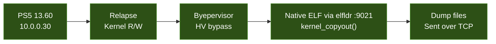
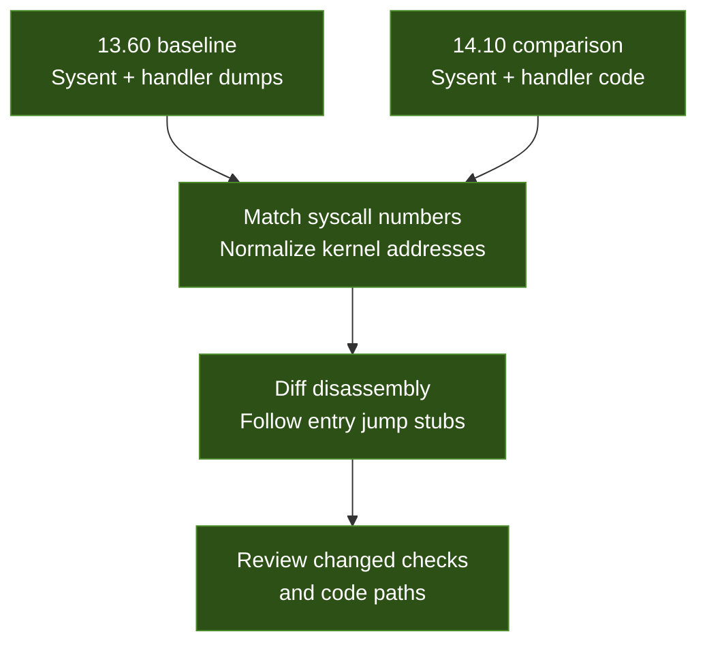

# PS5 Firmware 13.60 - Kernel Dumps

Raw kernel data dumps extracted from a jailbroken PS5 on firmware **13.60** using **Relapse + Byepervisor**.

> **Goal:** Map the Sony syscall table and handler code, then diff against **14.10** to find exploitable changes.

## Extraction Method



The native ELF is loaded through `elfldr` on TCP port **9021**, uses `kernel_copyout()` to read kernel memory, and sends the resulting dump files over TCP.

## Kernel Layout

| Property | Value |
|----------|-------|
| Firmware | 13.60 |
| Kernel base | `0xffffffff94480000` |
| Sysent RVA | `+0xe6e5c0` |
| Sysent entries | 679, with a 48-byte stride |
| Active handlers | 311 (368 entries are `nosys` stubs) |
| Sony syscalls (532-676) | 145 entries; 115 have non-`nosys` handlers in this capture |

The counts above are calculated from the captured `sysent_index.json`, treating the syscall 0 handler RVA (`+0x265760`) as the `nosys` stub.

## Files

These are the files captured in the current Relapse session:

| File | Size | Contents |
|------|------|----------|
| [`sysent_raw.bin`](sysent_raw.bin) | 32,592 B | Complete raw sysent table: 679 entries with a 48-byte stride. |
| [`sysent_index.json`](sysent_index.json) | 52,282 B | Parsed sysent entries with syscall number, argument count, `sy_call`, and handler RVA. |
| [`kernel_base.json`](kernel_base.json) | 55 B | Firmware version and kernel base recorded during extraction. |

The per-handler binaries, `ucred.bin`, and full `.text` / `.data` captures have not yet been collected. The complete sysent is available now; the handler disassembly command below applies after handler binaries are captured.

## JSON Format

`sysent_index.json` contains a top-level `kernel_base` hexadecimal string, a numeric `sysent_rva` (`15132096`, or `0xe6e5c0`), and an `entries` array. The following is the actual entry for syscall **532**:

```json
{
  "num": 532,
  "narg": 5,
  "sy_call": "0xffffffff946e5ce8",
  "sy_call_off": "0x265ce8"
}
```

| Field | Meaning |
|-------|---------|
| `num` | Syscall number and zero-based sysent entry index. |
| `narg` | Number of syscall arguments recorded in the entry. |
| `sy_call` | Absolute kernel virtual address of the handler or entry stub, stored as a hexadecimal string. |
| `sy_call_off` | Handler RVA relative to `kernel_base`, stored as a hexadecimal string: `sy_call - kernel_base`. |

Keep addresses as strings or use integer types that preserve all 64 bits when parsing them.

## Handler Disassembly

Run from a directory containing the downloaded handler dumps:

```bash
objdump -D -b binary -m i386:x86-64 handler_532.bin
```

This disassembles the raw bytes as x86-64 code with offsets starting at zero. Use the matching `sy_call` and `sy_call_off` values to relate those offsets to kernel addresses. Follow any entry jump stubs in a full `.text` dump when the target falls outside the captured 4 KB.

## Cross-Firmware Diffing

The sysent RVA **`+0xe6e5c0` matches across 13.60 and 14.10**, providing a common starting point for locating the syscall table. The shared table RVA does not establish that handler offsets or implementations are unchanged. Match entries by syscall number, then normalize addresses relative to each firmware's kernel base before comparing handler code.



| Change to look for | Research significance |
|--------------------|-----------------------|
| New bounds checks | May identify patched vulnerabilities, such as missing length or index validation in the older handler. Verify the affected data flow before concluding that a change fixes a vulnerability. |
| Removed code paths | May reveal functionality or reachable behavior that was disabled or replaced. Check callers and reachability in each firmware. |
| Changed argument validation | Compare argument counts, pointer checks, lengths, signedness, and rejected values to identify altered input handling. |

Prioritize semantic changes after accounting for relocated addresses and compiler differences. Use full handler bodies from the kernel `.text` dump to resolve differences that extend beyond these 4 KB windows.

## Known Offsets (13.60)

| Symbol | RVA | Notes |
|--------|-----|-------|
| Sysent table | `+0xe6e5c0` | 679 entries with a 48-byte stride. |
| `nosys` handler | `+0x265760` | Syscall 0's handler, shared by 368 entries in this index. |

## Next Steps

1. **Run the full kernel dumper** to capture `.text`, `.data`, and the module list.
2. **Diff every Sony handler against 14.10**, matching syscall numbers and following entry stubs.
3. **Update the research console to 14.00 for validation** after preserving the 13.60 dumps.
4. **Build a symbol table from the full `.text` dump** to label handlers, shared routines, and cross-references.

## Links

| Document | Contents |
|----------|----------|
| [Main README](../../README.md) | Project overview, exploit chain, and research status. |
| [Related 14.10 research](../RELATED_V14_10_RESEARCH.md) | Companion repository and cross-firmware research pointers. |
